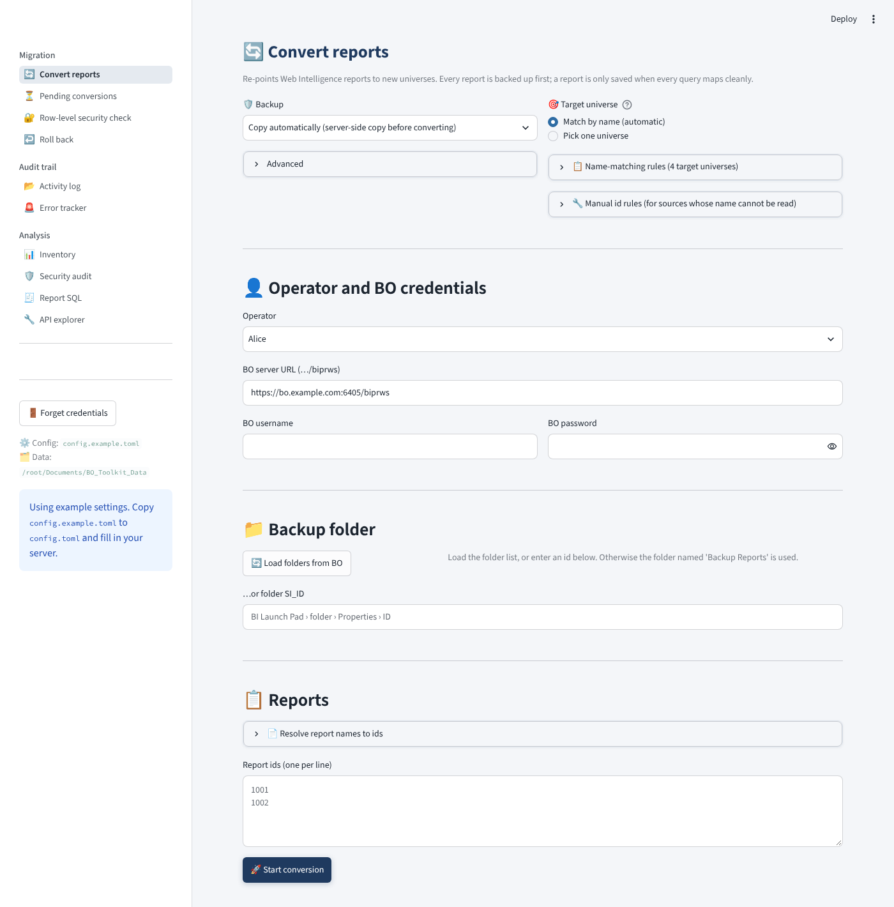

# 🔄 SAP BO Webi Toolkit

A Streamlit app for migrating **SAP BusinessObjects Web Intelligence** reports from legacy `.unv`
universes to `.unx`, and for auditing a BO system, all through the BI Platform RESTful Web Services
(`/biprws`, Raylight).

Migrating hundreds of reports by hand in BI Launch Pad means opening every report, changing the data source
of every query and hoping nothing silently breaks. This toolkit does it in bulk, with backups, verification
and an audit trail.



## Features

**Migration**
- **Bulk conversion:** re-points every query of a report to its target universe, either one fixed universe
  or **matched by name** per query, so one report can be split across several universes.
- **Safe by default:** each report is copied to a backup folder before it is touched. A report is saved only
  if every object maps. Ambiguous mappings are applied but flagged for review.
- **SQL structure check:** after mapping, the old and new SQL are compared by number of SELECT columns,
  WHERE conditions and JOINs. Table names are expected to change; a lost filter is not.
- **Optional row-count verification:** refresh before and after, compare totals, purge data before saving.
- **Partial conversions:** queries whose target universe isn't published yet are parked under
  *Pending conversions* and finished later with one click.
- **Rollback:** restores the backup's content over the original, keeping the same id, name and folder.
  This even works for `.unx → .unv`, which BO's own mapping refuses.
- **Row-level security check:** logs on as test users and verifies they only see allowed values
  (allow/deny rules per dimension).
- **Dry run:** checks every mapping without changing anything.

**Analysis** (read-only)
- Report counts per folder (direct and recursive) and member counts per user group, to spot empty groups.
- **Report → universe index** with conversion status (converted / partly / not converted), duplicate-name
  detection and a cached, parallel scan.
- Security audit: which group can view which report, own vs. inherited roles.
- Pull the SQL of reports by name and **search across all of it**.
- API explorer: data provider details, universe id lookup, WADL endpoint listing.

**Audit trail:** activity log, error tracker with "checked" flags, Excel exports with filters.

## Quick start

Requires Python 3.11+ and network access to a BO 4.2+ server.

```bash
git clone https://github.com/elif-droid/sap-bo-webi-toolkit.git
cd sap-bo-webi-toolkit
python -m venv .venv && source .venv/bin/activate   # Windows: .venv\Scripts\activate
pip install -r requirements.txt
cp config.example.toml config.toml                  # then edit it
streamlit run app.py
```

### Configuration

Everything environment-specific lives in `config.toml`, which is git-ignored:

| Section | What it holds |
|---|---|
| `[server]` | `url` of the `/biprws` endpoint |
| `[team]` | operators shown in the UI and written to the log |
| `[backup]` | backup folder name / prefix |
| `[universes]` | target `.unx` universes as `name = "id"` (find ids on the *API explorer* page) |
| `[conversion]` | date range and keywords used to answer date prompts |
| `[rls.columns]` | candidate column names per dimension for the security check |
| `[storage]` | where logs, rollback records and caches are written |

Row-level security rules are edited in the app and stored next to the logs
(see `examples/rls_rules.example.json` for the format).

## How a conversion works

```
for each report id
 ├─ session 1: copy report → backup folder  (POST /documents?sourceId=…, falls back to .wid download/upload)
 └─ session 2: for each data provider
     ├─ resolve target universe (fixed, or by source-universe name, or manual id rule)
     ├─ GET  …/dataproviders/mappings      → proposal; stop if any object has no target
     ├─ POST …/dataproviders/mappings      → apply, then verify dataSourceId changed
     └─ compare SQL structure before/after
    save (PUT /documents/{id}) only if no query failed → record rollback info
```

Conversion runs in a fresh session so the backup copy can never be the active document.

## Project structure

```
app.py              navigation and sidebar
bo/                 BO REST client: no Streamlit imports, unit-tested
  client.py         logon/logoff context manager, CMS queries, paging
  documents.py      documents, data providers, SQL, backups, prompts, purge
  mapping.py        universe resolution and conversion
  cms.py            folders, groups, report index, security
  sqltools.py       SQL structure comparison, extraction, search
  rls.py            row-level security rules
core/               config loader, local audit-trail storage
views/              one module per page
tests/              unit tests with a fake BO server and page smoke tests
```

```bash
pip install pytest && pytest -q
```

## Notes

- TLS verification is off by default (`bo/client.py`, `VERIFY_TLS`) because many on-premise servers use
  self-signed certificates. Turn it on if yours has a valid certificate.
- Credentials are kept only in the browser tab's session and are never written to disk.
- Some BI 4.x CMS versions silently ignore `WHERE` filters such as `SI_ANCESTOR`, so folder trees are walked
  through `/infostore/{id}/children` instead of CMS queries.

## License

MIT
